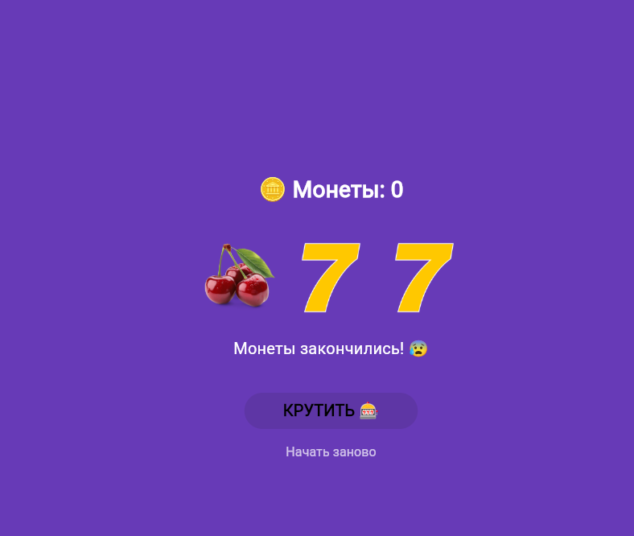

# Лабораторная работа №9.

* **Студент:** Истомин Максим
* **Группа:** ИСП-243
* **Дата:** 2.11.26

## Что изучено
* Разница между `StatelessWidget` и `StatefulWidget`.
* Подключение и вывод картинок через `pubspec.yaml`.
* Асинхронная логика анимации, задержками и проверкой.
* Использование виджетов анимации.

## Скриншот приложения


## Запуск проекта
```
flutter pub get
flutter run -d chrome
```